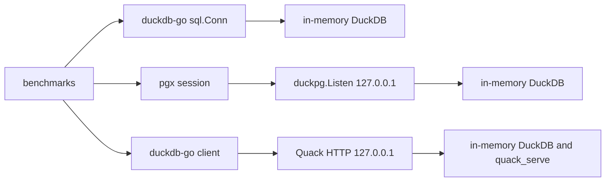

# benchmarks

## What is this

The benchmark measures localhost latency and throughput for duckdb-go, go-duckpg, and Quack, and it does not change the go-duckpg API.

## Access paths

- **direct**: duckdb-go reads an in-memory database through one pooled connection.
- **duckpg**: pgx uses the extended query protocol and binary results against `Listen` on `127.0.0.1`.
- **quack**: a DuckDB client attaches to `quack_serve` on `127.0.0.1` and sends each statement with `query`.

> [!NOTE]
> The Quack token is included in connection establishment. Timed statements use an attachment that is already open.

> [!NOTE]
> go-duckpg is started with no `Users` map, so this benchmark does not exercise authentication.

## Workloads

The benchmark loads one `bench` table of `id`, `k`, `s`, `amount`, and `ts`, and an empty `bench_ins` table for inserts. `-rows` sets the table size and defaults to 100000. Scan workloads also use 1000 and 10000 rows when those sizes fit in the table.

- **Connect**: time to open one session, reported as median and p99.
- **Select 1**: round trip for `SELECT 1`, reported as median and p99.
- **Aggregate**: `count(*)` and `sum(amount)` for the whole table, reported as median and p99.
- **Point read**: one row selected by an `id` literal, reported as median and p99.
- **Table scan**: five columns for each scan size, reported as median, p99, and rows/s.
- **Insert**: one autocommitted single-row insert, reported as median, p99, and tx/s.
- **Parallel**: four sessions run point reads, then four sessions run inserts, reported as median, p99, and aggregate qps or tx/s.

## Run

Run the default comparison:

```bash
go run ./benchmarks
```

Run a short smoke comparison. `-quick` uses 1000 rows when `-rows` is left at its default, and it lowers the iteration count:

```bash
go run ./benchmarks -quick
```

Pass `-rows` to choose the table size:

```bash
go run ./benchmarks -rows 10000
```

## How it works

### Architecture

Each path has its own in-memory DuckDB. The paths run one after another.



direct keeps one connection from the pool for a workload. duckpg accepts TCP on an ephemeral port and serves that database with no authentication. Quack installs the `quack` extension, calls `quack_serve` with a fixed token, and gives every query session its own DuckDB client. That client attaches the server and runs statements through the attachment's `query` macro, so the SQL executes on the server. The connect workload instead measures `ATTACH` and `CONNECT`, then discards that session: duckdb-go prepares every later statement, and DuckDB does not keep that prepared statement on a session after `CONNECT`.

### Core flow

The benchmark creates `bench` before the timer starts. It then reads `count(*)`, `sum(id)`, and `sum(amount)` through each path and stops when the results differ. Each workload discards a short warmup, records one wall-clock sample per iteration, and keeps the median and the 99th percentile. The ratio columns divide a path's elapsed time by direct's elapsed time. On a rate row the ratio is direct's rate divided by that path's rate, so a value above 1 still means the path is slower than direct. go-duckpg writes a connection log while workloads run, and the comparison table is printed after the last workload.
